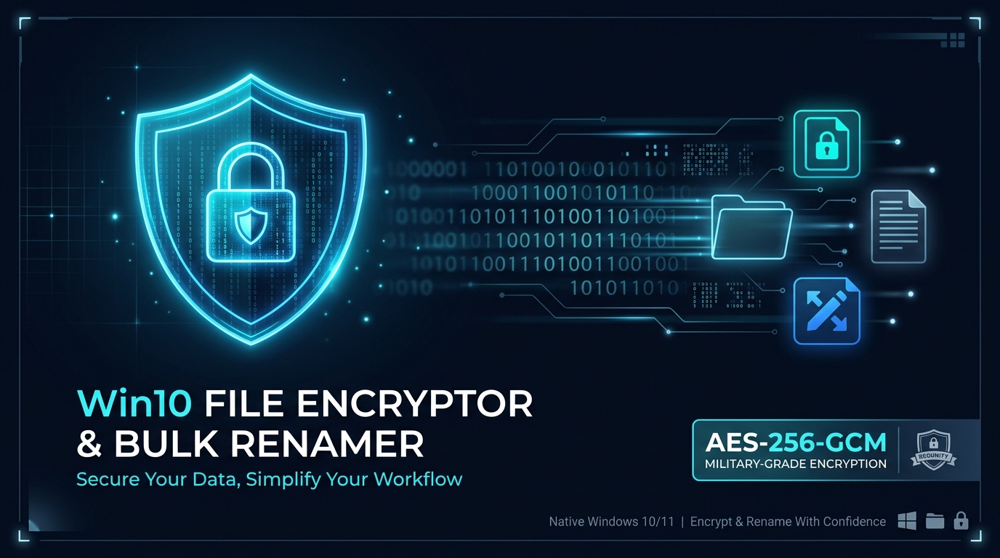

# Win10 File Encryptor & Bulk Renamer - Panduan Pengguna (User Guide)

> **Bahasa:** [English](USER_GUIDE.md) | [Bahasa Indonesia](USER_GUIDE.id.md)

Selamat datang di Panduan Pengguna **Win10 File Encryptor & Bulk Renamer**. Buku panduan ini memberikan instruksi lengkap langkah demi langkah mengenai konfigurasi keamanan, manajemen folder terproteksi, layanan auto-decrypt Windows Explorer, aturan penguncian otomatis (inactivity auto-lock), dan penggunaan fitur pengubah nama massal canggih.

---

## Daftar Isi
1. [Ringkasan & Kebutuhan Sistem](#1-ringkasan--kebutuhan-sistem)
2. [Pengaturan Keamanan Pertama Kali](#2-pengaturan-keamanan-pertama-kali)
3. [Autentikasi Master Password & Proteksi Akun](#3-autentikasi-master-password--proteksi-akun)
4. [Antarmuka Encrypt Explorer](#4-antarmuka-encrypt-explorer)
   - [Pohon Direktori & Penjelajahan Berkas](#pohon-direktori--penjelajahan-berkas)
   - [Sortir Kolom (Nama, Tipe, Ukuran, Tanggal, Status)](#sortir-kolom)
   - [Enkripsi Berkas & Folder Terpilih](#enkripsi-berkas--folder-terpilih)
   - [Dekripsi & Membuka Berkas Terproteksi](#dekripsi--membuka-berkas-terproteksi)
5. [Auto-Lock 30 Menit, Proteksi Instansi Tunggal & Penutupan](#5-auto-lock-30-menit-proteksi-instansi-tunggal--penutupan)
   - [Kunci Otomatis Inaktivitas 30 Menit](#kunci-otomatis-inaktivitas-30-menit)
   - [Proteksi Instansi Tunggal (Strict Single Instance)](#proteksi-instansi-tunggal-strict-single-instance)
   - [Penutupan Bersih Jendela (Bebas Ikon Ganda)](#penutupan-bersih-jendela-bebas-ikon-ganda)
   - [Pemulihan Otomatis Saat Restart atau Crash](#pemulihan-otomatis-saat-restart-atau-crash)
6. [Integrasi Layanan Latar Belakang Windows Explorer](#6-integrasi-layanan-latar-belakang-windows-explorer)
   - [Mengaktifkan Layanan Auto-Decrypt](#mengaktifkan-layanan-auto-decrypt)
   - [Menu Konteks Shell & Dekripsi Klik Ganda](#menu-konteks-shell--dekripsi-klik-ganda)
7. [Bulk File Renamer (Gaya Advanced Renamer)](#7-bulk-file-renamer-gaya-advanced-renamer)
   - [Metode 1: Ganti Teks (Find & Replace)](#metode-1-ganti-teks-find--replace)
   - [Metode 2: Tambah Teks (Prefix / Suffix)](#metode-2-tambah-teks-prefix--suffix)
   - [Metode 3: Pola Tag (<name>, <inc:01>)](#metode-3-pola-tag-name-inc01)
   - [Metode 4: Ubah Huruf Besar/Kecil](#metode-4-ubah-huruf-besarkecil)
   - [Metode 5: Pangkas Karakter (Trim)](#metode-5-pangkas-karakter-trim)
   - [Deteksi Tabrakan Nama & Fitur Batalkan (Undo)](#deteksi-tabrakan-nama--fitur-batalkan-undo)
8. [Pencari Berkas Duplikat (Duplicate File Finder)](#8-pencari-berkas-duplikat-duplicate-file-finder)
   - [Memilih Folder & Opsi Rekursif Sub-folder](#memilih-folder--opsi-rekursif-sub-folder)
   - [Algoritma 2-Fase Cepat (Ukuran & Hash SHA-256)](#algoritma-2-fase-cepat-ukuran--hash-sha-256)
   - [Tampilan Hasil dengan Checkbox Interaktif](#tampilan-hasil-dengan-checkbox-interaktif)
   - [Pilih Otomatis Salinan (Auto-Select Copies)](#pilih-otomatis-salinan-auto-select-copies)
   - [Penghapusan Aman ke Windows Recycle Bin](#penghapusan-aman-ke-windows-recycle-bin)
   - [Menu Konteks Klik Kanan](#menu-konteks-klik-kanan)
9. [Penggantian Bahasa Antarmuka (i18n)](#9-penggantian-bahasa-antarmuka-i18n)
10. [Pertanyaan yang Sering Diajukan (FAQ)](#10-pertanyaan-yang-sering-diajukan-faq)

---

## 1. Ringkasan & Kebutuhan Sistem

**Win10 File Encryptor & Bulk Renamer** adalah aplikasi desktop native berkinerja tinggi yang dirancang khusus untuk Windows 10 dan 11. Dibuat murni menggunakan C99 tanpa dependensi eksternal (seperti .NET runtime atau Electron), sehingga menghasilkan ukuran binary yang sangat kecil (< 1 MB) dan kecepatan eksekusi sub-milidetik.

### Spesifikasi Kebutuhan:
- **Sistem Operasi**: Windows 10 (Build 1809 ke atas) atau Windows 11 (disarankan 64-bit).
- **Arsitektur**: x86_64 (64-bit).
- **RAM**: Minimal 32 MB.
- **Ruang Hard Drive**: Kurang dari 2 MB.
- **Akselerasi Kriptografi**: Otomatis memanfaatkan set instruksi hardware AES-NI melalui modul bawaan Windows CNG (`bcrypt.dll`).

---

## 2. Pengaturan Keamanan Pertama Kali

Saat pertama kali membuka program, antarmuka **Pengaturan Keamanan Master** akan ditampilkan:

1. **Master Password**: Masukkan password minimal 4 karakter untuk melindungi akses tampilan utama.
2. **Konfirmasi Password**: Masukkan ulang password yang sama untuk memverifikasi.
3. **Alamat Email Pemulihan (Wajib)**:
   - Masukkan alamat email yang valid (contoh: `nama@domain.com`).
   - **Arsitektur Keamanan**: Kunci enkripsi AES-256 berkas Anda diturunkan secara murni dari email pemulihan ini menggunakan PBKDF2-HMAC-SHA256 dengan salt acak 128-bit unik per file. Manfaat utamanya:
     - Anda dapat membuka berkas `.enc` di komputer lain mana saja asalkan mendaftarkan email pemulihan yang sama.
     - Berkas Anda tidak akan hilang meskipun lupa Master Password lokal komputer Anda.
4. Klik **Daftarkan & Buka Aplikasi** (`Register & Open Application`).
5. Kredensial disimpan dengan enkripsi Windows DPAPI pada berkas `win10_file_enc_vault.dat`.

---

## 3. Autentikasi Master Password & Proteksi Akun

Pada penggunaan berikutnya, aplikasi menampilkan layar **Autentikasi Master Password**:

- Ketik Master Password dan tekan **Enter** atau klik tombol **Masuk**.
- **Lihat Karakter Password**: Centang kotak untuk memeriksa karakter yang diketik.
- **Mekanisme Proteksi Kunci Akun**:
  - Tampilan menampilkan jumlah percobaan gagal: `Percobaan gagal: 0 / 5`.
  - Jika terjadi 5 kali kegagalan berturut-turut, akses akun akan terkunci secara otomatis.
  - Untuk membuka kembali, klik **Lupa Password**. Kode verifikasi acak 6-digit (OTP) akan dikirimkan ke alamat email pemulihan Anda. Masukkan kode tersebut untuk mereset Master Password.

---

## 4. Antarmuka Encrypt Explorer

Setelah login sukses, Tab 1 menampilkan antarmuka penjelajah dua panel:

### Pohon Direktori & Penjelajahan Berkas
- **Panel Kiri (TreeView)**: Menampilkan seluruh drive sistem (`C:\`, `D:\`, dll.) dan pohon foldernya dengan ikon Windows asli.
- **Panel Kanan (ListView)**: Menampilkan daftar file dan sub-folder di direktori yang sedang dipilih dalam mode rincian (*Report View*).
- **Bilah Alamat Folder**: Menampilkan jalur path folder aktif. Anda bisa mengetik langsung atau klik **Browse...** untuk memilih folder.
- **Pindai Sub-folder**: Dicentang untuk menyertakan sub-direktori ke dalam proses enkripsi massal.
- **Ingat folder**: Menyimpan folder terakhir yang dikunjungi saat aplikasi dibuka kembali.

### Sortir Kolom
Klik pada header kolom mana saja untuk mengurutkan daftar secara instan:
- **Nama Berkas / Folder**: Urutan alfabetis (A-Z atau Z-A).
- **Tipe**: Urutan berdasarkan ekstensi dan deskripsi jenis berkas.
- **Ukuran**: **Sortir numerik akurat** dari byte riil 64-bit (misal: `2.1 MB` otomatis berada sebelum `10.4 MB`).
- **Tanggal Dimodifikasi**: Urutan kronologis dari yang terlama ke terbaru atau sebaliknya.
- **Status Enkripsi**: Mengelompokkan status berkas terenkripsi, didekripsi, dan berkas asli.
- **Indikator Panah Segitiga**: Menampilkan panah native Windows (▲ Ascending, ▼ Descending) pada kolom aktif.
- **Folder Selalu di Atas**: Mengikuti standar Windows Explorer asli, folder selalu dikelompokkan di bagian atas berkas.

### Enkripsi Berkas & Folder Terpilih
1. Pilih satu atau beberapa berkas di panel daftar:
   - Klik untuk memilih satu berkas.
   - Tahan tombol `Ctrl` atau `Shift` untuk memilih banyak berkas tertentu.
   - Tekan `Ctrl+A` atau klik kanan pilih **Pilih Semua**.
2. Klik kanan pada berkas terpilih:
   - **🔒 Enkripsi berkas yang dipilih**: Mengenkripsi berkas dengan AES-256-GCM, menghancurkan berkas plaintext asli secara permanen (*shred*), dan menyimpannya sebagai format `.enc`.
   - **📁 Enkripsi seluruh folder ini**: Mengenkripsi semua berkas yang ada di dalam folder tersebut.
3. Perkembangan enkripsi ditampilkan pada progress bar dan kotak log di bagian bawah.

### Dekripsi & Membuka Berkas Terproteksi
- **Klik Kanan**: Pilih **🔓 Dekripsi berkas yang dipilih**.
- **Klik Ganda (Double-Click)**: Mengklik ganda pada berkas `.enc` akan otomatis mendekripsinya, mencatatnya ke dalam sistem pengawasan 30 menit, membukanya dengan aplikasi default Windows, dan mengubah statusnya menjadi `🔓 Didekripsi (Auto-lock 30m)`.

---

## 5. Auto-Lock 30 Menit, Proteksi Instansi Tunggal & Penutupan

Untuk menjaga kerahasiaan data di memori dan disk, aplikasi menerapkan sistem pengamanan berlapis otomatis:

### Kunci Otomatis Inaktivitas 30 Menit
- Setiap berkas yang didekripsi dicatat ke dalam **Decrypted File Tracker**.
- Selama program berjalan, timer background memeriksa status setiap 15 detik.
- Jika berkas yang terbuka **tidak disentuh/dibuka lagi selama 30 menit berturut-turut**:
  - Program otomatis mengenkripsi kembali berkas tersebut menjadi `.enc` (AES-256-GCM).
  - Berkas plaintext dihancurkan secara aman dari disk (*secure shredding*).
  - Notifikasi balon system tray muncul mengabarkan bahwa berkas telah diamankan.
- **Reset Otomatis saat Bekerja**: Jika Anda mengedit dan menyimpan file pada aplikasi luar (misal: Word, Notepad, IDE), perubahan waktu berkas otomatis terdeteksi dan timer 30 menit akan di-reset kembali dari awal.

### Proteksi Instansi Tunggal (Strict Single Instance)
- Aplikasi dilindungi secara ketat oleh **Windows Named Mutex** (`Win10FileMod_App_SingleInstance_Mutex`).
- Sistem memastikan hanya ada **tepat 1 instansi jendela** dari program ini yang berjalan bersamaan.
- Jika Anda meluncurkan kembali `win10_file_enc.exe` saat program sudah berjalan:
  - Jendela yang sedang aktif otomatis dipulihkan (*restored*) dari kondisi terminimalkan/tersembunyi dan langsung dibawa ke baris terdepan layar pengguna.
  - Proses kedua langsung berhenti tanpa menimbulkan duplikasi aplikasi di memori.

### Penutupan Bersih Jendela (Bebas Ikon Ganda)
- Menekan tombol **Close (X)** pada judul jendela atau shortcut `Alt+F4` akan **menutup antarmuka grafis aplikasi secara tuntas** dan **membersihkan ikon tray utama**.
- Desain ini secara tuntas menyelesaikan masalah penumpukan 2 ikon perisai di taskbar notification area, sehingga tray hanya menampilkan ikon daemon background jika service aktif.
- **Keamanan Penutupan Penuh**: Saat antarmuka ditutup, seluruh berkas yang masih dalam status didekripsi akan **otomatis dienkripsi kembali ke format `.enc`** dan salinan plaintext-nya dihancurkan secara permanen.

### Pemulihan Otomatis Saat Restart atau Crash
Jika komputer mengalami restart tiba-tiba, pemadaman listrik, atau crash:
- Berkas pelacak persisten `win10_file_enc_tracker.dat` mengingat status berkas yang sempat didekripsi.
- Saat aplikasi utama atau background service berjalan pertama kali setelah restart, sistem langsung memindai dan **mengenkripsi kembali seluruh berkas plaintext yang tertinggal**, memastikan keamanan data tetap terjamin.

---

## 6. Integrasi Layanan Latar Belakang Windows Explorer

Aplikasi menyediakan background service daemon dan integrasi shell Windows Explorer:

### Mengaktifkan Layanan Auto-Decrypt
1. Buka menu **Layanan** (`Service`) pada menu bar atas.
2. Klik **Pasang Integrasi Windows Explorer** (`Install Explorer Integration`).
3. Klik **Aktifkan Layanan Background** (`Enable Background Service`).
4. Layanan akan berjalan di latar belakang (dapat berjalan otomatis saat startup Windows lewat argumen `--service`).

### Menu Konteks Shell & Dekripsi Klik Ganda
- **Di Windows Explorer**: Membuka folder yang berisi berkas `.enc` akan otomatis mendekripsi berkas tersebut secara instan.
- **Klik Ganda Langsung**: Mengklik ganda berkas `.enc` di Windows Explorer langsung memicu opsi `--auto-decrypt`, memulihkan berkas asli dan meluncurkan aplikasinya.

---

## 7. Bulk File Renamer (Gaya Advanced Renamer)

Klik tab **🏷️ Bulk File Renamer** pada bilah navigasi atas untuk mengubah nama banyak berkas sekaligus:

### Metode 1: Ganti Teks (Find & Replace)
- **Cari (Find)**: Kata/frasa yang ingin dicari (case-insensitive).
- **Ganti Dengan**: Teks baru penggantinya.
- *Contoh*: Mencari `gambar_` dan menggantinya dengan `foto_liburan_` mengubah `gambar_01.jpg` menjadi `foto_liburan_01.jpg`.

### Metode 2: Tambah Teks (Prefix / Suffix)
- **Awalan (Prefix)**: Menambahkan teks di awal nama berkas.
- **Akhiran (Suffix)**: Menambahkan teks di akhir nama berkas sebelum tanda titik ekstensi.

### Metode 3: Pola Tag (`<name>`, `<inc:01>`)
- Gunakan tag dinamis:
  - `<name>`: Mempertahankan nama asli berkas.
  - `<inc:1>`: Penomoran 1, 2, 3...
  - `<inc:01>`: Penomoran 01, 02, 03... (padding 2 angka nol).
  - `<inc:001>`: Penomoran 001, 002, 003... (padding 3 angka nol).
  - Pengaturan nilai awal dan langkah kelipatan angka dapat disesuaikan.
- *Contoh*: Pola `Dokumen_<inc:01>` mengubah berkas menjadi `Dokumen_01.pdf`, `Dokumen_02.pdf`.

### Metode 4: Ubah Huruf Besar/Kecil
- Pilihan:
  - **Semua Huruf Kecil**: `laporan_keuangan.xlsx`
  - **SEMUA HURUF BESAR**: `LAPORAN_KEUANGAN.XLSX`
  - **Huruf Judul**: `Laporan Keuangan.Xlsx`

### Metode 5: Pangkas Karakter (Trim)
- Memangkas sejumlah `N` karakter dari bagian awal atau akhir nama berkas.

### Deteksi Tabrakan Nama & Fitur Batalkan (Undo)
- **Pratinjau Langsung (Live Preview)**: Kolom *Nama Baru* terupdate seketika saat Anda mengetik atau mengganti metode.
- **Deteksi Konflik Duplikasi**: Jika ada dua berkas yang akan menghasilkan nama yang sama persis, baris tersebut ditandai dengan peringatan (*Collision Warning*) untuk mencegah penimpaan berkas yang tidak disengaja.
- **Fitur Batalkan (Undo)**: Klik tombol **↩️ Batalkan Rename (Undo)** untuk mengembalikan seluruh berkas yang baru saja diubah namanya ke nama aslinya dalam satu klik.

---

## 8. Pencari Berkas Duplikat (Duplicate File Finder)

Klik tab **🔍 Pencari Berkas Duplikat** pada bilah navigasi atas untuk memindai, menemukan, dan membersihkan berkas-berkas duplikat di folder pilihan Anda guna menghemat ruang penyimpanan hard disk.

### Memilih Folder & Opsi Rekursif Sub-folder
1. Klik tombol **Pilih Folder...** (`Browse...`) untuk memilih direktori yang ingin Anda periksa.
2. Centang **Pindai Sub-folder** (`Scan Subfolders`) jika Anda ingin memindai seluruh direktori anak secara rekursif, atau hilangkan centang jika hanya ingin memindai folder tingkat atas.
3. Klik tombol **Mulai Pindai** (`Scan Duplicates`). Anda dapat membatalkan pemindaian sewaktu-waktu dengan menekan tombol **Hentikan** (`Stop`).

### Algoritma 2-Fase Cepat (Ukuran & Hash SHA-256)
Aplikasi menggunakan algoritma dua tahap berkinerja tinggi:
- **Fase 1 (Penyaringan Ukuran Cepat)**: Membaca informasi ukuran berkas dari sistem berkas Windows. Berkas-berkas dengan ukuran yang unik langsung diabaikan tanpa membaca isi berkas dari disk.
- **Fase 2 (Verifikasi Konten SHA-256)**: Hanya berkas-berkas yang memiliki ukuran sama persis yang dibaca dan dihitung hash kriptografi **SHA-256**-nya (menggunakan Windows CNG `bcrypt.dll`). Dua berkas hanya dinyatakan sebagai duplikat jika isi bit kontennya terbukti identik 100%.

### Tampilan Hasil dengan Checkbox Interaktif
Hasil pemindaian ditampilkan dalam tabel daftar berkas (*ListView*) dengan kolom:
- **Kotak Centang (Checkbox)**: Menandai berkas yang akan dihapus ke Recycle Bin.
- **Nama Berkas**: Nama berkas duplikat.
- **Status**:
  - `[Asli]` (`[Original]`): Berkas pertama yang ditemukan dalam grup duplikat.
  - `[Salinan]` (`[Copy]`): Berkas duplikat tambahan yang identik.
- **Ukuran**: Ukuran berkas dalam format ramah pengguna (`KB`, `MB`, `GB`).
- **Tanggal Dimodifikasi**: Waktu modifikasi terakhir berkas.
- **Path Lengkap**: Jalur lokasi absolut berkas pada media penyimpanan.

### Pilih Otomatis Salinan (Auto-Select Copies)
Untuk membersihkan duplikat dengan aman tanpa menghapus berkas yang asli:
1. Klik tombol **Pilih Otomatis Salinan** (`Auto-Select Copies`).
2. Program akan secara otomatis mencentang semua berkas berstatus `[Salinan]` dan **tetap mengosongkan centang pada 1 berkas `[Asli]`** di setiap kelompok duplikat.
3. Tersedia juga tombol pintasan **Pilih Semua** (`Select All`) dan **Batal Pilih Semua** (`Deselect All`).

### Penghapusan Aman ke Windows Recycle Bin
1. Setelah memeriksa berkas-berkas yang dicentang, klik tombol **Hapus ke Recycle Bin** (`Delete to Recycle Bin`).
2. Kotak dialog konfirmasi keamanan akan muncul menampilkan jumlah berkas terpilih dan **estimasi kapasitas disk yang akan dihemat** (misal: *Anda yakin ingin memindahkan 12 berkas duplikat (345.2 MB) ke Recycle Bin?*).
3. Berkas dihapus menggunakan Windows Shell API (`SHFileOperationW` dengan flag `FOF_ALLOWUNDO`), sehingga berkas **tetap aman dan dapat dipulihkan kapan saja** dari Recycle Bin Windows jika dibutuhkan.

### Menu Konteks Klik Kanan
Klik kanan pada baris berkas di tabel duplikat untuk memanggil fungsi cepat:
- **Buka Berkas** (`Open File`): Menjalankan berkas menggunakan aplikasi default Windows.
- **Tampilkan di Explorer** (`Show in Explorer`): Membuka folder lokasi berkas dan langsung menyorot (*highlight*) berkas tersebut.
- **Tandai / Batalkan Centang**: Mengubah status checkbox baris yang dipilih.
- **Hapus Berkas Ini**: Menghapus hanya satu berkas yang diklik ke Recycle Bin.

---

## 9. Penggantian Bahasa Antarmuka (i18n)

Aplikasi mendukung lokalisasi dinamis secara langsung:
- Buka menu **🌐 Bahasa** (`🌐 Language`) di menu bar.
- Pilih bahasa:
  - **English (Default)**
  - **Bahasa Indonesia**
- Seluruh teks label tombol, judul dialog, kolom penjelajah, tab halaman, dan notifikasi tray berganti seketika tanpa perlu me-restart aplikasi.

---

## 10. Pertanyaan yang Sering Diajukan (FAQ)

#### T: Mengapa aplikasi tidak mengizinkan membuka jendela baru jika aplikasi sudah berjalan?
**J**: Sesuai arsitektur proteksi instansi tunggal (*Strict Single Instance*), aplikasi memanfaatkan Windows Mutex untuk mencegah duplikasi proses di memori dan menghindari tabrakan berkas pelacak enkripsi (`win10_file_enc_tracker.dat`). Jika Anda membuka kembali program, jendela yang sudah ada akan otomatis dipulihkan ke baris terdepan layar Anda.

#### T: Mengapa ikon di taskbar notification area tidak bertumpuk menjadi 2 saat aplikasi ditutup?
**J**: Versi terbaru telah mengoptimalkan siklus penutupan jendela. Saat tombol Tutup ([X] / Close) diklik, antarmuka jendela utama keluar secara bersih dan menghapus ikon tray-nya sendiri, sementara layanan latar belakang (jika diaktifkan via `--service`) tetap beroperasi mandiri tanpa menimbulkan ikon ganda.

#### T: Di mana berkas hasil enkripsi disimpan?
**J**: Berkas hasil enkripsi disimpan di folder yang sama dengan berkas asli dengan ekstensi tambahan `.enc` (misal: `catatan.txt` menjadi `catatan.txt.enc`).

#### T: Bisakah berkas dibuka di komputer lain?
**J**: **Bisa!** Selama komputer lain tersebut menjalankan aplikasi ini dan Anda memasukkan alamat email pemulihan yang sama persis, berkas `.enc` dapat didekripsi di mana saja.

#### T: Bisakah berkas asli dipulihkan setelah dilakukan pemusnahan (secure shredding)?
**J**: **Tidak bisa.** Berkas asli ditimpa secara fisik dengan pola nol dan acak, serta di-flush ke controller perangkat keras sebelum dihapus. Software recovery data (seperti Recuva) hanya akan menemukan byte kosong.

#### T: Apakah berkas duplikat yang dihapus benar-benar hilang permanen?
**J**: **Tidak.** Penghapusan pada modul Pencari Duplikat memindahkan berkas ke Windows Recycle Bin (`FOF_ALLOWUNDO`). Anda dapat membuka Recycle Bin di desktop Windows dan melakukan *Restore* jika ingin mengembalikan berkas tersebut.
